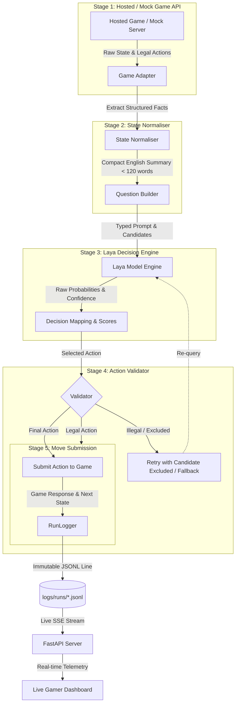

# Beat the Bot — Teach Laya to Play

> **A modular, transparent decision layer powering game-playing agents exclusively through Laya, featuring real-time telemetry, empirical Decision Autopsy, and tamper-proof run reproducibility.**

---


## 2. Problem Statement

Autonomous game agents powered by language or multi-modal models often suffer from opacity: moves are made without clear causal attribution, hallucinations lead to illegal actions, and catastrophic failures are discovered only after an entire run terminates. 

**Beat the Bot** solves this by establishing a modular, strictly auditable decision layer for hosted game challenges revealed on hackathon day. The bot consumes game states, asks **Laya** structured typed questions, transforms Laya's output probability distributions into legal moves, validates constraints, and immutably logs every single decision step for live streaming and post-run autopsy.

---

## 3. System Architecture & The 5-Stage Pipeline

The engine executes in a disciplined five-stage pipeline where Laya is the sole decision-maker:



---

## 4. Four Core Unique Selling Points (USPs)

1. **Decision Autopsy (USP 1):** Turns every failed move into an empirical investigation, classifying outcomes into six deterministic verdicts (`illegal_move`, `game_over`, `confident_miss`, `uncertain_miss`, `lucky_hit`, `as_predicted`) with testable explanatory hypotheses.
2. **Question Lab (USP 2):** Benchmarks alternative prompt formulations (e.g. perception-first *"Which lane is blocked?"* vs direct-action control *"Which move to take?"*) across identical game seeds and evaluates measurable score and latency gains.
3. **Reproducible Run Replay (USP 3):** Enables step-by-step forensic replay of any recorded run, backing up claims with SHA-256 hashes, exact line numbers in raw `.jsonl` files, and full move-to-Laya traceability.
4. **Confidence Reality Check (USP 4):** Measures whether Laya's reported probabilities correlate with actual game success using Expected Calibration Error (ECE) and reliability diagrams, explicitly warning against small-sample overconfidence.

---

## 5. Non-Negotiable Rules & Audit Integrity

- **Laya is the Sole Move Arbiter**: No other model, heuristic policy, random chooser, hard-coded move, or browser automation is permitted to select a move.
- **Traceability**: Every submitted move traces to a recorded Laya call in `logs/runs/<session_id>.jsonl`. The only exception is the highest-scoring still-legal action from Laya's previous scores if retries are exhausted (explicitly flagged as a fallback).
- **No Data Fabrication**: Scores, latencies, probabilities, qualifying scores, and verification flags remain `null` or `"unknown"` unless verified by official sources. Demo data is prominently labeled `DEMO_UNVERIFIED`.
- **Zero Secret Leakage**: Credentials, cookies, and tokens are recursively redacted before logs touch disk.

---

## 6. Installation & Quickstart

### Prerequisites
- Python 3.10+ (tested on Python 3.10, 3.11, 3.12, 3.13)
- Git

### Local Setup
```bash
# 1. Clone the repository
git clone https://github.com/shelartanmay75-cyber/Genesis_26.git
cd Genesis_26

# 2. Create and activate a virtual environment
python -m venv .venv
# On Windows PowerShell:
.venv\Scripts\Activate.ps1
# On Linux/macOS:
source .venv/bin/activate

# 3. Install dependencies
pip install -r requirements.txt
```

### Running Locally
```bash
# Terminal 1: Start the backend server & static web host
python -m server --port 8000

# Terminal 2: Run a mock game session with the bot loop
python -m bot.loop --game mock --steps 20

# Terminal 3 (Optional): Run the synthetic demo feeder for UI testing
python -m server.demo_feeder --steps 15 --interval 1.0
```
Open **[http://127.0.0.1:8000](http://127.0.0.1:8000)** in your browser to view the Gamer HUD live dashboard.

---

## 7. Running on Google Colab

To run headless training, Question Lab benchmarks, or Laya inference on Google Colab:
1. Open a new notebook and install the environment:
   ```bash
   !git clone https://github.com/shelartanmay75-cyber/Genesis_26.git
   %cd Genesis_26
   !pip install -r requirements.txt
   ```
2. Execute bot runs or Question Lab benchmarks:
   ```bash
   !python -m experiments.run_lab --variants perception_first direct_control --games 10
   ```
3. To view the dashboard from Colab, launch the server with a tunnel (e.g. `localtunnel` or `ngrok`):
   ```python
   import subprocess
   server_proc = subprocess.Popen(["python", "-m", "server", "--port", "8000"])
   ```

---

## 8. How to Reproduce and Verify a Best Run

All top-performing runs are archived in `logs/best/` with tamper-evident hashes documented in [`docs/best_runs.md`](file:///docs/best_runs.md).

```bash
# 1. Verify that every single move came from a logged Laya call
python scripts/check_every_move_logged.py <session_id> --logs-dir logs/best

# 2. Verify file SHA-256 integrity and step continuity
curl http://127.0.0.1:8000/api/runs/<session_id>/verify

# 3. Run Decision Autopsy on the run
python -m bot.autopsy logs/best/<session_id>.jsonl

# 4. View exact latency and move statistics
python scripts/log_stats.py logs/best/<session_id>.jsonl
```

---

## 9. Repository Layout & Team Lanes

```text
Genesis_26/
├── bot/
│   ├── adapters/          # [Lane A] Game adapters (mock & game-day)
│   ├── normaliser.py      # [Lane A] Plain-English state summariser
│   ├── validator.py       # [Lane A] Constraint checking & retry policy
│   ├── loop.py            # [Lane A] Main bot game loop
│   ├── laya/              # [Lane B] Laya inference & model loader
│   ├── questions/         # [Lane B] Question set formulation registry
│   ├── calibration.py     # [Lane B] Confidence reality check (ECE & bins)
│   ├── logger.py          # [Lane D] Atomic JSONL logging & secret redaction
│   └── autopsy.py         # [Lane D] Decision Autopsy analyser (USP 1)
├── contracts/             # [Lane D] JSON Schemas (Draft 2020-12), examples, and API spec
├── server/                # [Lane D] FastAPI backend, SSE live stream, and demo feeder
├── web/                   # [Lane C] Static HTML/CSS/Vanilla JS Gamer HUD dashboard
├── experiments/           # [Lane B] Question Lab benchmarking suite
├── mock_game/             # [Lane A] Deterministic local mock game server
├── logs/
│   ├── runs/              # Runtime log storage (*.jsonl, *.summary.json)
│   └── best/              # Preserved top-run evidence logs
├── scripts/               # [Lane D] Lane check, best runs, stats, and audit tools
├── docs/                  # [Lane D] Autopsy method, write-up, notes, best runs
├── requirements/          # Lane-specific dependency manifests (a.txt, b.txt, d.txt)
├── requirements.txt       # Root dependency aggregator
└── lanes.json             # Boundary enforcement mapping
```

### Lane Ownership
- **Member A (`feat/game-integration`)**: Game adapters, mock game, normaliser, validator, game loop.
- **Member B (`feat/laya-engine`)**: Laya model loading, question sets, Question Lab, calibration.
- **Member C (`feat/frontend`)**: Gamer HUD dashboard (`web/`), live run viewer, autopsy & replay tabs.
- **Member D (`feat/server-logs`)**: Contracts, logger, FastAPI server, SSE stream, autopsy, replay store, repo hygiene.

---

## 10. Credits & Licences

- **Laya Model**: Developed by **Nandakishor M** (Convai Innovations). Licensed under **Apache-2.0**.
- **Visual Design & State-Questions-Probabilities Paradigm**: Inspired by **laya-playground** and [brainfunctioncollapse.com/laya](https://brainfunctioncollapse.com/laya) by **brain function collapse** (MIT License).
- **Beat the Bot Platform**: MIT License &copy; 2026 Beat the Bot Team.
